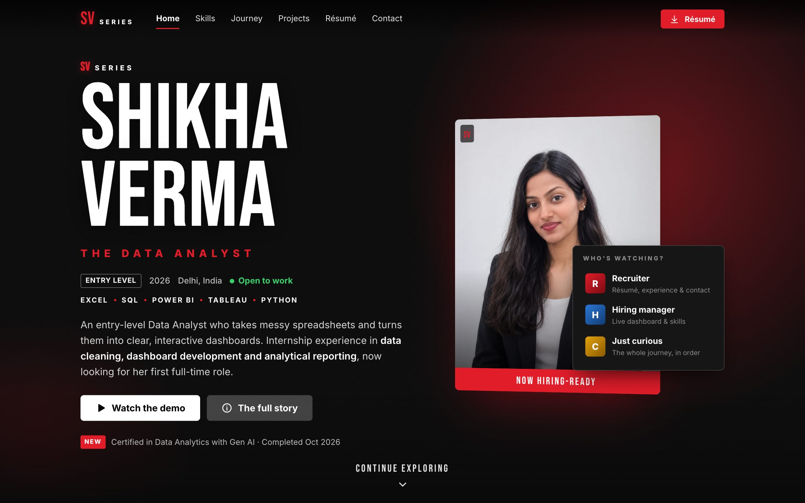
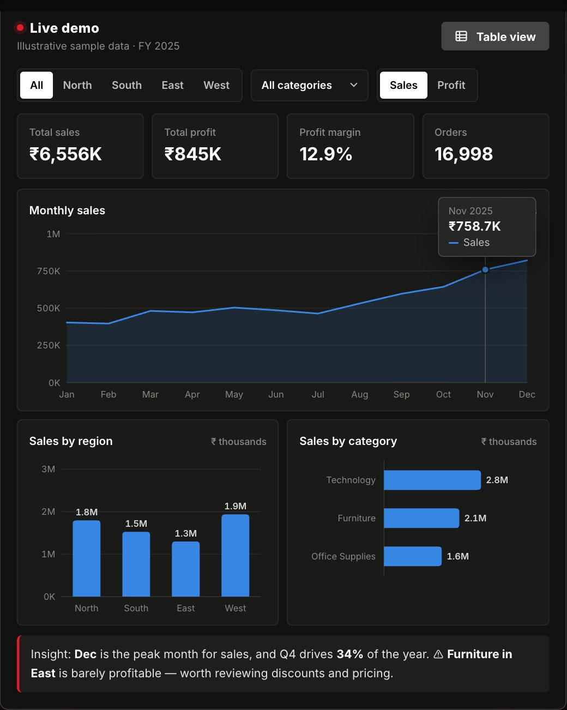
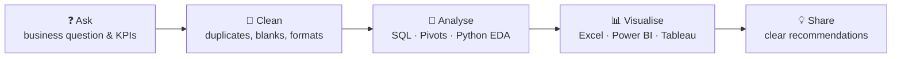
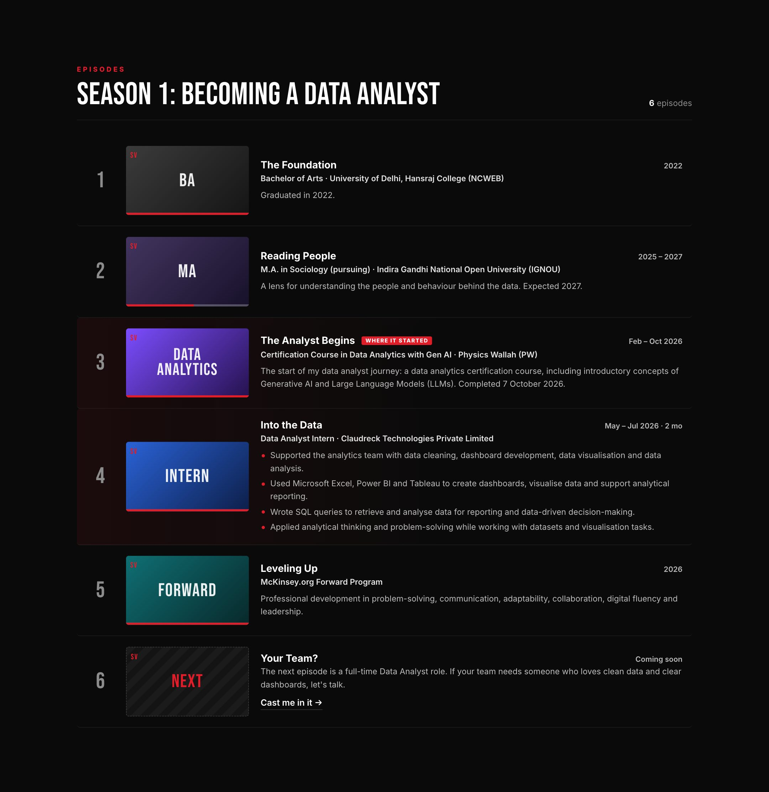
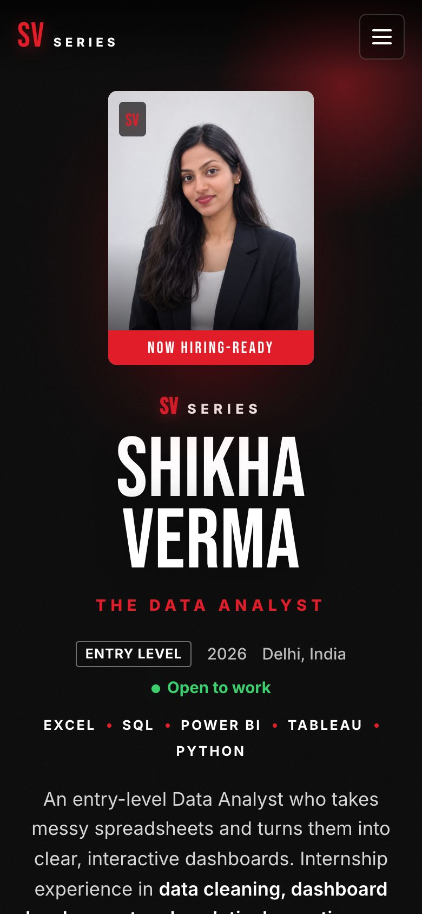
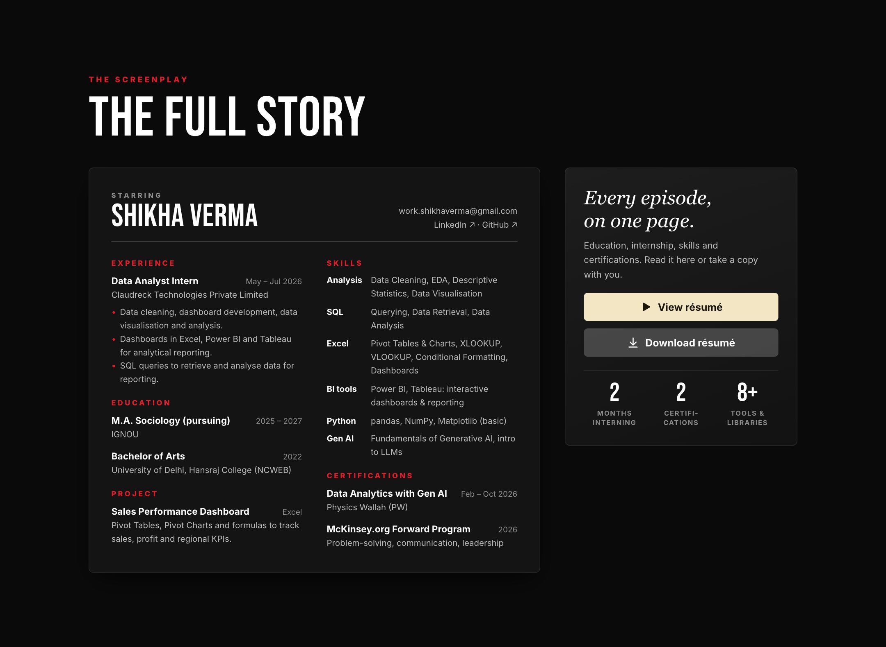
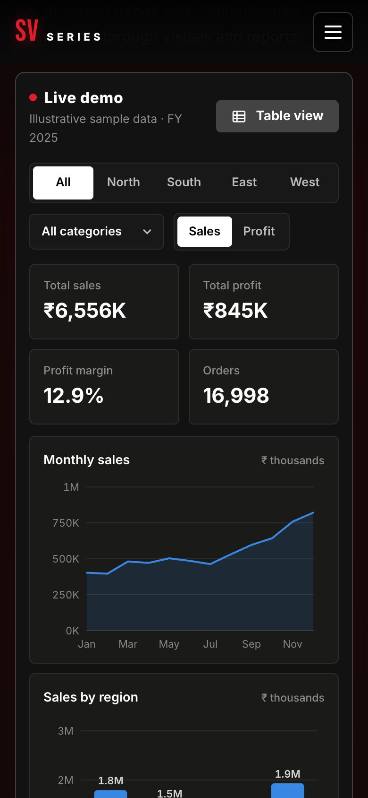

<div align="center">

<a href="https://shikhaverma09.github.io/data-analyst-portfolio/">
  
</a>

# Shikha Verma · Data Analyst Portfolio

**Entry-level Data Analyst** turning messy spreadsheets into clear, interactive dashboards.<br />
Delhi, India · Open to Data Analyst roles

[](https://shikhaverma09.github.io/data-analyst-portfolio/)
[](assets/Shikha_Verma_Resume.pdf)
[](https://www.linkedin.com/in/shikha-verma9112)
[](mailto:work.shikhaverma@gmail.com)


[](https://github.com/shikhaverma09/data-analyst-portfolio/actions/workflows/deploy.yml)

</div>

---

## 📌 At a glance

| | |
|---|---|
| **Role** | Entry-level Data Analyst |
| **Experience** | Data Analyst Intern, Claudreck Technologies Pvt. Ltd. (May – Jul 2026) |
| **Core tools** | Excel · SQL · Power BI · Tableau |
| **Also** | Python (pandas, NumPy, Matplotlib), EDA, descriptive statistics, Gen AI fundamentals |
| **Certification** | Data Analytics with Gen AI, Physics Wallah (Feb – Oct 2026) |
| **Education** | M.A. Sociology (IGNOU, pursuing) · B.A. (University of Delhi, Hansraj College) |

---

## 📊 Featured project: Sales Performance Dashboard

> **Business question:** *Where is the business making (and losing) money, and when?*

<table>
<tr>
<td width="58%">



</td>
<td width="42%">

**Built in:** Microsoft Excel (Pivot Tables, Pivot Charts, formulas)

**What I did**
1. **Cleaned** raw sales data: fixed formats, blanks and duplicates
2. **Modelled** it with Pivot Tables by month, region and category
3. **Tracked KPIs:** sales, profit, margin and orders
4. **Visualised** trends and regional performance with Pivot Charts
5. **Reported** insights to support decisions

**▶ [Try the live version](https://shikhaverma09.github.io/data-analyst-portfolio/#originals)**: filter by region and category, switch between sales and profit, hover for exact values, click a bar to cross-filter, or open the table view.

</td>
</tr>
</table>

### KPIs tracked

| KPI | Definition | Why it matters |
|---|---|---|
| **Total Sales** | `SUM(Sales)` | Overall revenue size and trend |
| **Total Profit** | `SUM(Profit)` | What the business actually keeps |
| **Profit Margin** | `Total Profit ÷ Total Sales` | Spots segments that sell a lot but earn little |
| **Orders** | `COUNT(Order ID)` | Demand volume, separate from price |
| **Sales by Region / Category** | Pivot by dimension | Shows where to focus or fix |

### Example findings (from the demo's illustrative data)

- 📈 **Seasonality:** sales peak in **December**, and **Q4 drives ~34%** of annual sales, so stock and staffing should be planned around it.
- ⚠️ **Margin leak:** **Furniture in the East** region is barely profitable despite steady sales. The first thing to review is discounting and pricing.
- 🏆 **Best margin:** **Technology** carries the healthiest margin (~18%), making it the strongest category to grow.

<sub>The live demo uses generated sample data to show the analysis approach. No confidential company data is included.</sub>

---

## 🔄 How I work



---

## 🧰 Skills

| Area | Skills | Level |
|---|---|---|
| **Data analysis** | Data cleaning, EDA, descriptive statistics, data visualisation |  |
| **SQL** | Querying, data retrieval, data analysis |  |
| **Excel** | Pivot Tables & Charts, XLOOKUP, VLOOKUP, conditional formatting, dashboards |  |
| **Power BI & Tableau** | Interactive dashboards, analytical reporting |  |
| **Python** | pandas, NumPy, Matplotlib |  |
| **Generative AI** | Gen AI fundamentals, introduction to LLMs |  |
| **Soft skills** | Analytical thinking, problem solving, communication, time management, leadership, adaptability |  |

---

## 🎬 The journey: Season 1, *Becoming a Data Analyst*

| Ep | When | Episode |
|:--:|---|---|
| 1 | 2022 | **The Foundation:** B.A., University of Delhi, Hansraj College (NCWEB) |
| 2 | 2025 – 2027 | **Reading People:** M.A. Sociology (pursuing), IGNOU |
| 3 | Feb – Oct 2026 | **The Analyst Begins:** Certification in Data Analytics with Gen AI, Physics Wallah |
| 4 | May – Jul 2026 | **Into the Data:** Data Analyst Intern, Claudreck Technologies Pvt. Ltd. |
| 5 | 2026 | **Leveling Up:** McKinsey.org Forward Program |
| 6 | Coming soon | **Your Team?** My first full-time Data Analyst role. [Let's talk →](mailto:work.shikhaverma@gmail.com) |

---

## 🖥️ Portfolio preview

<table>
<tr>
<td width="70%"></td>
<td width="30%"></td>
</tr>
<tr>
<td></td>
<td></td>
</tr>
</table>

**Highlights**
- 🎬 Cinematic "series" theme with a *Who's watching?* path picker (Recruiter, Hiring manager, Curious)
- 📊 Live, interactive sales dashboard: filters, cross-filtering, tooltips and a table view
- 📱 Fully responsive, tested from 320px phones to 2560px monitors
- ⚡ Fast: plain HTML/CSS/JS, no frameworks, about 60 fps scrolling, keyboard accessible

<details>
<summary><b>🛠️ Under the hood</b> (structure, run locally, deployment)</summary>

```
index.html
assets/
  css/style.css            # theme, layout, responsive rules
  js/main.js               # navigation, scroll reveals, skill row, copy email
  js/dashboard.js          # interactive sales dashboard (hand-built SVG charts)
  img/                     # portrait + favicon
  Shikha_Verma_Resume.pdf
.github/
  workflows/deploy.yml     # auto-deploys to GitHub Pages on every push to main
  readme/                  # screenshots used in this README
```

**Run locally**

```bash
python3 -m http.server 8000
# open http://localhost:8000
```

**Deployment:** every push to `main` runs the GitHub Actions workflow, which publishes the site to GitHub Pages.

</details>

---

<div align="center">

### 📫 Let's connect

I'm actively looking for **entry-level Data Analyst** opportunities.

[](mailto:work.shikhaverma@gmail.com)
[](https://www.linkedin.com/in/shikha-verma9112)

</div>
